# HighTech Store

An online shop for PC hardware with a **PC builder that checks whether the parts fit together**, a full checkout,
payments confirmed by signed webhooks, refunds, and an admin area. Laravel 13 API, Vue 3 front end, PostgreSQL.

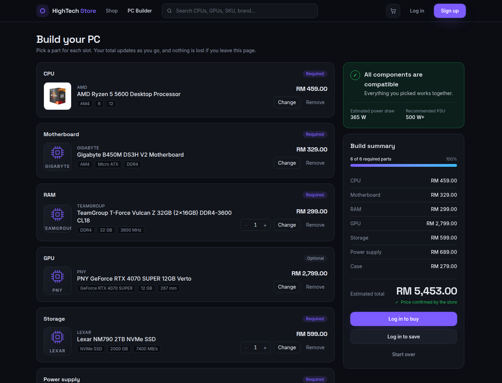

It is a portfolio project, built to show the parts of an online shop that are easy to get subtly wrong: money, stock,
payments and permissions. A few things worth looking at first:

- **Nothing the browser sends is trusted for money.** Prices, totals, discounts and shipping are worked out by the server
  from its own data, in whole sen, and the database refuses an order whose total does not add up.
- **The last unit cannot be sold twice.** Stock is reserved under row locks, and a test proves it by racing eight real
  checkout processes for three units.
- **A payment is believed only from a signed webhook, and only once.** Duplicates, forgeries, replays, late payments and
  wrong amounts each have a defined, tested outcome.
- **Compatibility is a rule engine, not a pile of `if`s.** Sixteen small rules that an admin can switch off or tune
  without a deployment.
- **A suggested PC is only a proposal until the shop has checked it.** The shop's own rules, or optionally an AI, pick
  parts for a budget. Either way the result is priced and judged by the same code as any other build, so an AI cannot
  invent a product, a price or a part that does not fit.
- **The API reference is generated from the code and then tested against real answers**, so it cannot be out of date
  and cannot be wrong without a test failing.

| | |
|---|---|
| 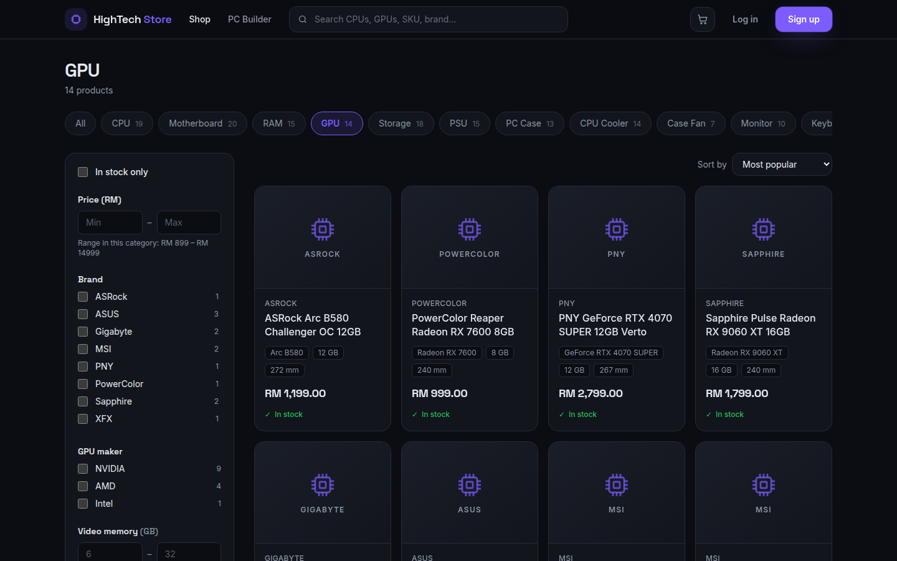 | 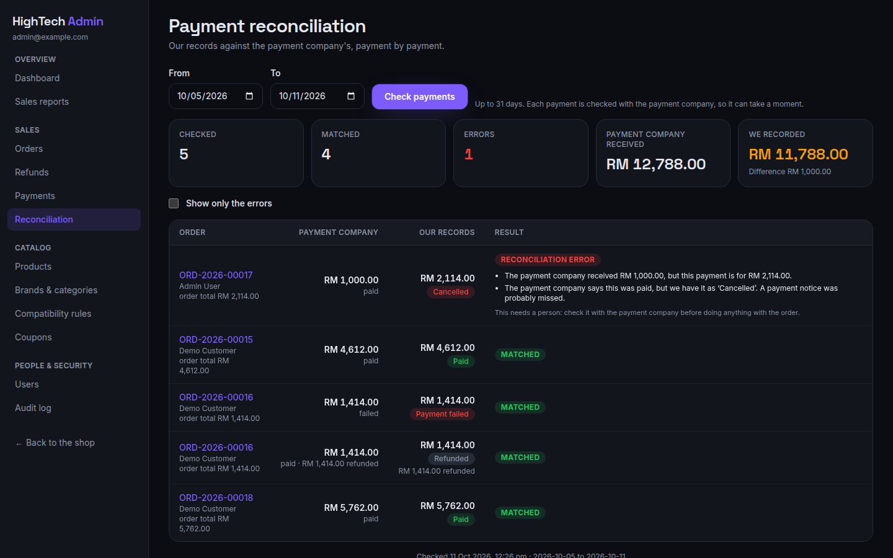 |
| The catalog. Every filter comes from the database | Reconciliation, catching a payment that disagrees |
| 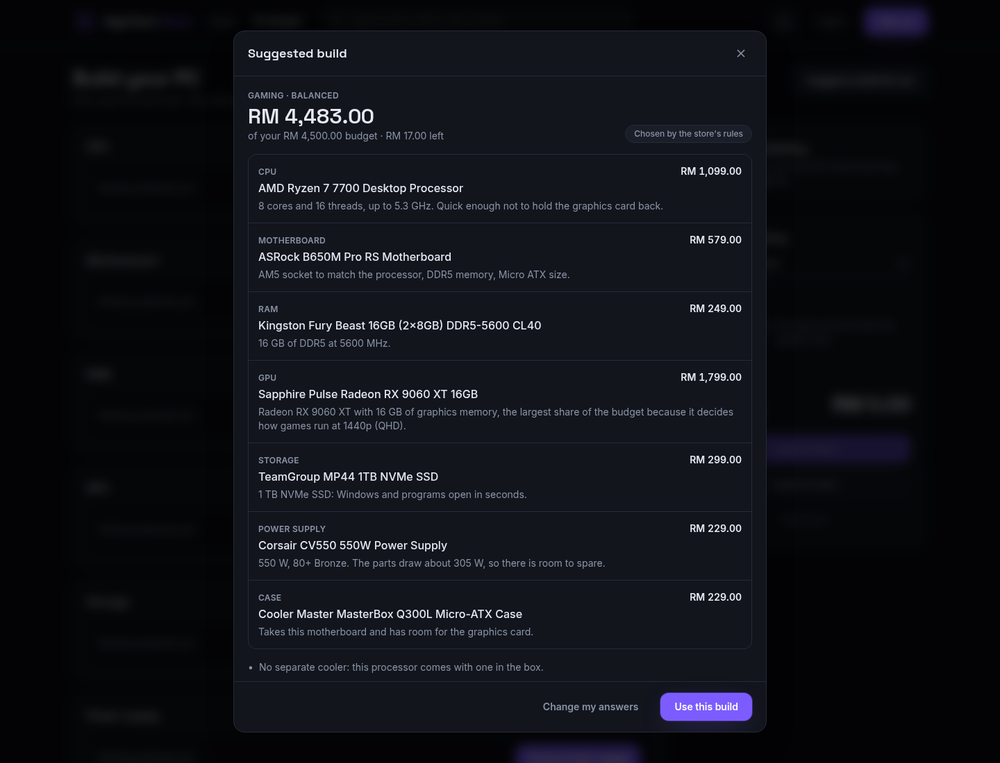 | 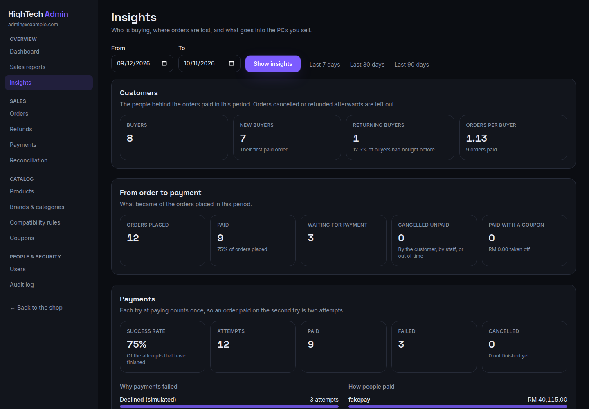 |
| "Suggest a build for me": a PC for a budget, with reasons | Insights for the people running the shop |
| 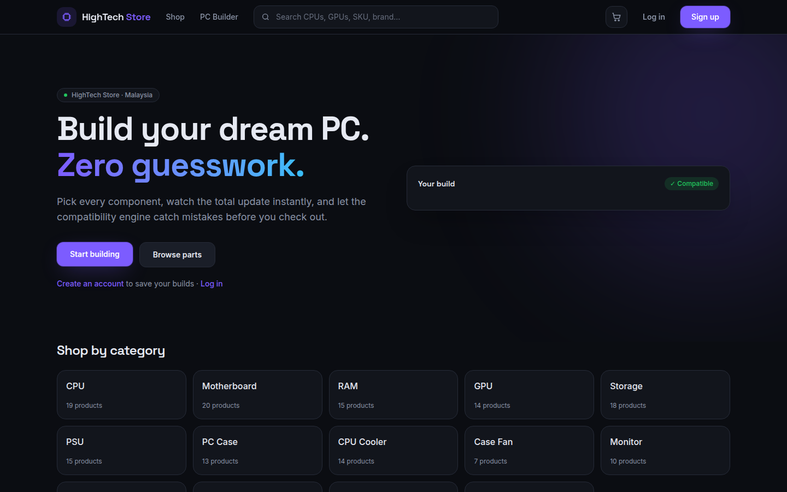 | 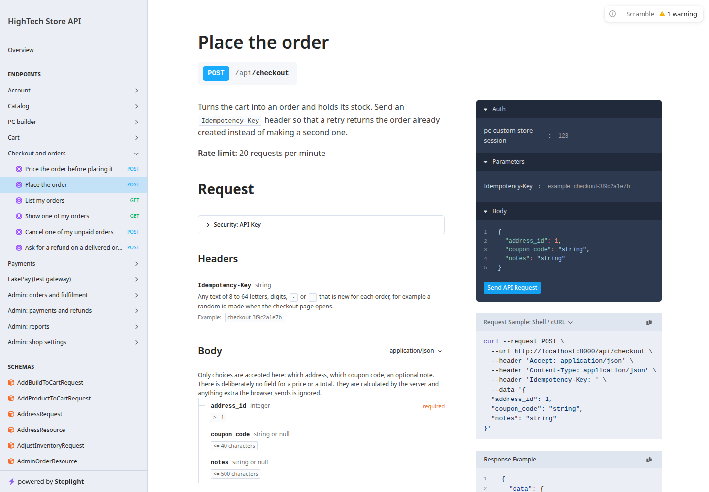 |
| Home | The API reference |

## Contents

- [Features](#features) · [Technology](#technology) · [Architecture](#architecture) · [Database design](#database-design)
- [Getting started](#getting-started) · [API documentation](#api-documentation) · [Tests and quality checks](#tests-and-quality-checks)
- [Payment architecture](#payment-architecture) · [Webhook architecture](#webhook-architecture) · [PC compatibility architecture](#pc-compatibility-architecture) · [Build suggestions](#build-suggestions)
- [Security](#security) · [Deployment](#deployment) · [Project layout](#project-layout) · [Future improvements](#future-improvements)

## Features

**Shop**
- Catalog of about 170 seeded products in 14 categories, with search across name, SKU, brand and category, and
  filters, sorting and product specifications that are all generated from data
  ([details](docs/catalog-and-pc-builder.md)).
- Cart holding single products and whole PCs, re-priced and re-checked against stock every time it is read.
- Checkout with an address book, coupons (percentage or fixed, with limits), and shipping by region.
- Orders with a timeline, cancellation while unpaid, and refund requests after payment.
- Emails for each step (placed, paid, shipped, delivered, payment failed, refund decided).

**PC builder**
- Pick a part for each slot; the list for the next slot shows what fits first and hides what does not.
- Live verdict (compatible, warnings, incompatible) with the reason for each problem, estimated power draw and a
  recommended power supply.
- Save, rename, copy and buy builds. A saved build stores which parts, never prices, so it is never stale.
- **Suggest a build for me**: give a budget and what the PC is for, and get a complete PC from the catalog with a
  reason for each part. Chosen by the shop's own rules, or by an AI service if one is switched on.
- **Share a build by link**: anyone with the link sees the parts at today's prices and can load a copy into their own
  builder. The owner can switch the link off.

**Payments**
- A payment layer that talks to an interface, with a built-in simulator ("FakePay") that behaves like a real gateway:
  its own payment page, signed webhooks delivered by a queue, retries and refunds.
- Refunds (customer requests, staff decisions, partial amounts, retries) that cannot pay out twice.
- Reconciliation of the shop's records against the payment company's, with every disagreement explained.

**Admin**
- Dashboard and sales reports with CSV export, in the shop's own time zone.
- Insights: new and returning buyers, what became of the orders placed, how payment attempts ended and why they failed,
  whole PCs against single items, the parts chosen most, and how build suggestions are used.
- Orders and fulfilment, refunds, payments with their full history, products and stock, brands, categories and their
  specifications, compatibility rules, coupons, users and roles, and a read-only audit log.
- Two staff levels by permission: staff run the shop day to day; only admins move money or manage people.

## Technology

| Layer | Technology |
|---|---|
| API | Laravel 13, PHP 8.5, Sanctum (cookie login for the single-page app) |
| Front end | Vue 3 (Composition API, `<script setup>`), Pinia, Vue Router, Axios, Tailwind CSS 4, Vite |
| Database | PostgreSQL 17 |
| Tests and checks | Pest, PHPStan (level 5, Larastan), Pint · Vitest, Vue Test Utils, ESLint, Prettier |
| API reference | OpenAPI 3.1, generated by Scramble |
| Development | Docker Compose: API, queue worker, scheduler, database, front end, Mailpit |
| Delivery | GitHub Actions; a single production container (nginx, PHP-FPM, queue worker, scheduler) |

## Architecture

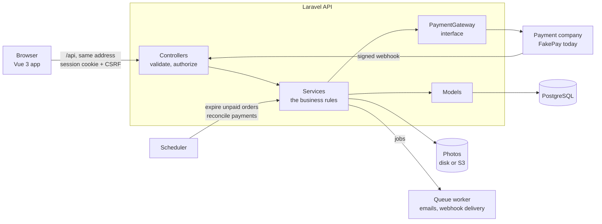

Two applications in one repository. `backend/` is an API with no pages of its own; `frontend/` is the Vue app. The
browser always reaches both through one address (the Vite server forwards `/api` in development, the web host does in
production), which is what allows the login to be an `httpOnly` cookie instead of a token that scripts could read.

Inside the API, controllers stay thin. They hand validated input to a **service**, and services are the only place
that changes money, stock or status, always inside a database transaction.

Some of the decisions, with the reasoning in [docs/architecture.md](docs/architecture.md):

| Decision | Why |
|---|---|
| Money is a whole number of sen in a `Money` value object | Decimals drift; whole numbers can be checked exactly by the database |
| The server decides every amount | Anything a browser sends can be edited by its user |
| Permissions are data, checked on the route | Who may do what changes more often than code |
| Product specifications are data, not columns | Filters, forms and validation are generated; a new kind of part needs no code |
| An order has two statuses (the goods, the money), each with a list of allowed moves | "Paid but not shipped" and "shipped but refunded" are both real |
| Stock is reserved by the order, under row locks taken in a fixed order | Stops overselling without deadlocks |
| Only a signed webhook marks an order paid, recorded in the same transaction as its effects | The return page proves nothing; a retry must be harmless |
| Tests run on PostgreSQL | The rules that matter (locks, `CHECK`s, partial indexes, a trigger) only exist there |

## Database design

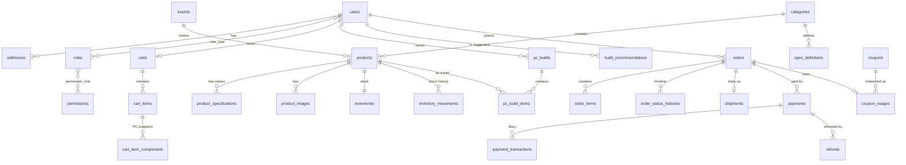

Framework tables are left out, as are `webhook_events`, `audit_logs` and `compatibility_rules`, which stand apart.

The rules that must never break are written into the database as well as the code: an order's total must add up
(`CHECK`), reserved stock cannot exceed stock, refunds cannot exceed the payment, only one payment page and one refund
request may be open per order (partial unique indexes), the same webhook or checkout is recorded once (unique keys), and
a payment's history cannot be edited (a trigger). The full list is in
[docs/architecture.md](docs/architecture.md#what-the-database-itself-refuses).

## Getting started

### Installation

The only requirement is **Docker** with Compose. PHP, Composer, Node and PostgreSQL all run in containers.

```bash
git clone <this repository> hightech-store && cd hightech-store
./scripts/setup.sh                                   # .env files, images, PHP and JavaScript packages
docker compose up -d                                 # start everything
docker compose exec app php artisan migrate --seed   # tables, roles, demo accounts, demo catalog
```

Then open:

| | Address |
|---|---|
| The shop | http://localhost:5173 |
| The API reference | http://localhost:8000/docs/api |
| Mailpit (every email the shop sends) | http://localhost:8025 |
| PostgreSQL | `127.0.0.1:5434`, credentials in `.env` |

### Environment setup

`scripts/setup.sh` creates two files from their `.example` templates, with a random database password in both, and
refuses to overwrite existing ones. Neither is committed.

| File | For | Notable settings |
|---|---|---|
| `.env` | Docker Compose | Ports (`APP_PORT`, `FRONTEND_PORT`, `DB_FORWARD_PORT`, `MAILPIT_PORT`), database name, user and password |
| `backend/.env` | Laravel | `APP_URL`, `FRONTEND_URL`, `DB_*`, `SANCTUM_STATEFUL_DOMAINS`, `PAYMENT_PROVIDER`, `PAYMENT_WEBHOOK_SECRET`, `SHOP_TIMEZONE`, `IMAGE_DISK`, `RECOMMENDER_DRIVER` (and `AI_*` when it is `ai`), mail |

If a port is already taken on your computer, change it in `.env` and run `docker compose up -d` again.

### Docker setup

| Service | What it runs |
|---|---|
| `app` | The Laravel API |
| `queue` | The queue worker: emails, and FakePay's webhook deliveries |
| `scheduler` | Timed jobs: cancelling unpaid orders after 30 minutes, checking undecided payments with the gateway |
| `db` | PostgreSQL 17, with a second database for the tests |
| `frontend` | The Vite development server |
| `mailpit` | Catches every email so none leaves your computer |

`docker compose logs -f app` follows the API's log; `docker compose down` stops everything and keeps the data.

### Database migration

```bash
docker compose exec app php artisan migrate          # apply new migrations
docker compose exec app php artisan migrate:status   # what has been applied
```

Migrations only ever add; none of them needs data to be thrown away.

### Seed instructions

`php artisan migrate --seed` (or `php artisan db:seed`) creates:

- the roles and permissions, and the compatibility rules' default settings (safe to re-run anywhere);
- **in local development only**: three demo accounts, the demo catalog and two coupons (`WELCOME10`, `SAVE50`).

| Role | Email | Password |
|---|---|---|
| Admin | admin@example.com | Password123 |
| Staff | staff@example.com | Password123 |
| Customer | customer@example.com | Password123 |

Demo accounts are never created outside the `local` and `testing` environments. A server gets its first admin from
`php artisan shop:install` instead ([Deployment](#deployment)).

To try a purchase: add something to the cart, check out, press **Pay**, and choose an outcome on the FakePay page. The
order's emails appear in Mailpit.

## API documentation

The reference is at **http://localhost:8000/docs/api** while the app runs, and in the repository as
[`backend/openapi.json`](backend/openapi.json) (OpenAPI 3.1, ready for Postman or any other tool). It covers 94
operations in 11 groups. For each one: the address and method, whether a login and which permission it needs, its rate
limit, the request body with its limits, every answer with its shape, and the errors it can return. An introduction
covers logging in, the money format, the error shape, paging, idempotent checkout and webhook signatures.

It is **generated from the code** (routes, validation rules, response classes) by Scramble, so it cannot be forgotten.
It is also **tested against real answers**: `backend/tests/Feature/ApiDocs` makes about 90 calls to 64 of the
operations and fails if an answer is missing a documented field, has a different type, contains an undocumented field,
or uses a status the reference does not list. Another test fails if `openapi.json` is out of date. After changing the
API:

```bash
docker compose exec app composer docs
```

## Tests and quality checks

```bash
docker compose exec app ./vendor/bin/pest            # 870 backend tests, on the pc_store_testing database
docker compose exec app composer analyse             # static analysis: PHPStan level 5
docker compose exec app ./vendor/bin/pint --test     # PHP code style
docker compose exec frontend npm test                # 452 front-end tests
docker compose exec frontend npm run lint            # ESLint
docker compose exec frontend npm run format:check    # Prettier
docker compose exec frontend npm run build           # the production build
```

The backend tests run against real PostgreSQL and never touch development data: `phpunit.xml` forces the testing
database. Besides the usual feature and unit tests there are three less usual kinds:

- **Concurrency tests** (`tests/Concurrency`) start separate PHP processes and release them at the same instant. Eight
  customers check out a product with three left: exactly three orders, five clean refusals, no shared order number.
  Removing the stock lock, or the cart lock, fails a test.
- **Reference tests** check the API reference against real answers (above).
- **Deployment tests** cover the install command, the photo storage check and the guard that refuses to put the shop's
  tables where a database host would publish them.

**Continuous integration** (`.github/workflows/ci.yml`) runs all of the above on every push and pull request, and also
builds the production image, starts it against an empty database and checks that it migrated, serves the shop, hides
dot-files and sends its security headers. A weekly job audits PHP and JavaScript packages for known vulnerabilities.

## Payment architecture

The shop talks to a `PaymentGateway` **interface** with five methods: start a payment, read a webhook, ask for a
payment's status, refund, and fetch the company's own record for reconciliation. A payment company is one class that
implements it, chosen by `PAYMENT_PROVIDER`. Adding one means writing that class; checkout, refunds and reconciliation
do not change.

- A payment is always created for **the order's own total**. The request to start paying has no body.
- A payment's every step is appended to `payment_transactions`, which a database trigger makes impossible to edit.
- Paying turns **reserved** stock into **sold** stock in the same transaction that marks the order paid.
- A payment that arrives after its order was cancelled is kept, flagged for refund, and never revives the order.
- Refunds mark themselves as in progress before the company is called, call it outside the database transaction, and
  use the refund's id as the idempotency key, so a timeout or a double click cannot pay out twice.
- **Reconciliation** compares every payment with the company's own record and explains each difference. It never
  "fixes" a wrong amount by itself.

The included gateway, **FakePay**, is a simulator with its own payment page, real HTTP webhooks signed with a shared
secret and delivered by the queue, retries and refunds. It refuses to run when `APP_ENV=production`. No real gateway is
included. [More in docs/payments-and-refunds.md](docs/payments-and-refunds.md).

## Webhook architecture

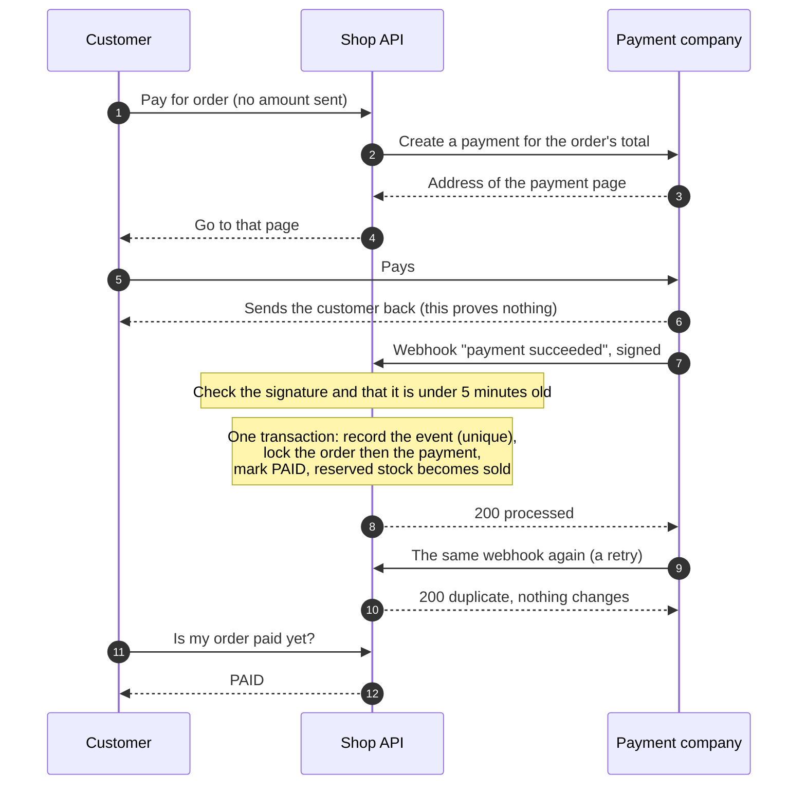

| What can go wrong | What happens |
|---|---|
| A forged or altered webhook | Refused with `401`: the signature is an HMAC-SHA256 of the time and the exact body, compared in constant time |
| A genuine webhook replayed later | Refused: older than five minutes |
| The same webhook delivered twice | The event's id is unique. The second delivery finds it and answers `200 duplicate` |
| Processing fails half way | The whole transaction rolls back, including the record that the event was seen, and the answer is `500`, so the company's retry is processed normally |
| Events arrive out of order | Rows are locked in a fixed order and every move is checked against the current state: "failed" after "paid" is ignored |
| The amount differs | Not accepted. The payment stays unpaid and the difference is written down |
| A webhook never arrives | A scheduled job asks the company about undecided payments and feeds the answer through the same code path |

## PC compatibility architecture

Each check is a small class in `backend/app/Services/Compatibility/Rules` (CPU socket against motherboard, RAM type,
whether the graphics card fits the case, whether the power supply covers the estimated load, and so on; sixteen in
all). `CompatibilityService` runs the enabled ones and returns a verdict: **compatible**, **warning** or
**incompatible**. Errors block buying a build; warnings never do.

- **One source of truth.** The same service judges the builder's live verdict, the list of parts offered for a slot,
  adding a PC to the cart, every read of the cart and checkout.
- **Rules read data, not product types.** A rule asks for a specification by key (`socket`, `ram_type`,
  `gpu_max_length_mm`). If a part or a value is missing it stays silent instead of guessing, and a test fails if a rule
  asks for a key the catalog does not define.
- **Tunable without a deployment.** Each rule's on/off switch, severity and numbers (for example the spare power a
  supply should have) live in the database, with safe defaults when a row is missing.
- **Adding a rule** is one class and one line of configuration. Rules are plain objects and are unit-tested without a
  database.
- **Suggesting parts.** For "which motherboards fit this CPU", every candidate is judged against the build so far and
  returned compatible first, then warnings, then incompatible (hidden unless asked for).

[More in docs/catalog-and-pc-builder.md](docs/catalog-and-pc-builder.md#compatibility-engine).

## Build suggestions

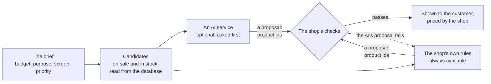

"Suggest a build for me" turns a budget and a purpose into a complete PC. Whatever chooses the parts only **proposes**
a list of product ids; the shop then checks the proposal like any build a customer puts together.

- **The rules always work.** They split the budget by purpose (a gaming PC spends most on the graphics card, an office
  PC uses the processor's built-in graphics), pick the best part each share buys, and trade parts up or down until the
  build fits. No account, no cost, and the same answer every time for the same catalog.
- **An AI is optional.** With `RECOMMENDER_DRIVER=ai` an AI service is asked first, through the common "OpenAI chat
  completions" format, so the service can be changed with three settings. It is sent the brief and a shortlist of real
  products. It is never sent anything about a customer.
- **Neither is trusted.** Every product must be one that was offered; the build must be complete, in stock and
  compatible according to `BuildEvaluator` (the code behind the builder, the cart and checkout); and the total at the
  shop's prices must be within the budget. A price the AI states is never read.
- **The customer always gets an answer.** If the AI is slow, down, over its allowance, or proposes something that fails
  a check, the rules answer instead. Why the AI was not used is recorded by kind, and shown to admins in Insights.

The AI path is tested by playing the AI service (in the test suite, and over real HTTP against a stand-in that answers
well, invents products, picks clashing parts, answers in prose, fails and times out). It has not been run against a
real AI company's service, which needs an account.
[More in docs/catalog-and-pc-builder.md](docs/catalog-and-pc-builder.md#build-suggestions).

## Security

- Login is an `httpOnly` session cookie with CSRF protection; login and registration are rate limited.
- Every staff action needs a permission on its route; every record is checked for ownership. Another customer's order
  answers `404`.
- Uploaded images are decoded and re-encoded as WebP under a random name.
- Every error is `{ "message": ... }` and nothing else, whatever the debug setting.
- Security headers on the API and the website, including a content policy with no `unsafe-*` allowances, verified in a
  real browser across the whole site. Only the shop's own website may read API answers from a browser.
- A shared build is found only by a 40-character random token, names neither its owner nor its id, and can be
  switched off by the owner.
- An AI service, when one is switched on, receives products and a budget, never customer data, and decides nothing.
- An append-only audit log of who did what, with secrets stripped.

The full list is in [docs/architecture.md](docs/architecture.md#security).

## Deployment

`backend/Dockerfile` builds one container that runs nginx, PHP-FPM, the queue worker and the scheduler. On start it
checks its settings, waits for the database, migrates, and runs `php artisan shop:install`, which creates the roles,
the compatibility rules and the first admin from `ADMIN_EMAIL` and `ADMIN_PASSWORD`. Everything it does is safe to
repeat. The front end is a static build (`npm run build`) for any static host.

**[docs/hosting-free.md](docs/hosting-free.md)** is a step-by-step guide to a free public demo: the website on
Netlify, the API on Render, and the database and product photos on Supabase. It covers the limits of each free plan and
what to do when something goes wrong, and how to switch on AI build suggestions with a free service (optional).

Two things a real shop needs that this repository does not include: a **real payment gateway** (FakePay refuses to run
in production) and a **mail service** (the default writes emails to the log).

## Project layout

```
backend/                  the Laravel API
  app/Http/               controllers, form requests, resources, middleware
  app/Services/           the business rules: Cart, Catalog, Compatibility, Orders, Payments, PcBuilder, Recommendations, Reports
  app/Models/  app/Enums/ app/Policies/  app/Notifications/
  database/               migrations, factories, seeders
  tests/                  Unit, Feature, Concurrency
  deploy/  Dockerfile     the production container
  openapi.json            the published API reference
frontend/                 the Vue app
  src/pages/  src/components/  src/stores/  src/lib/  src/router/
  tests/
docs/                     architecture, feature pages, the hosting guide
docker/  docker-compose.yml   the development environment
.github/workflows/        continuous integration
netlify.toml              the website's build, forwarding and security headers
```

## Future improvements

Not built, in rough order of value:

- **A real payment gateway** (Stripe, Billplz or toyyibPay) as a second implementation of the interface, and refunds
  that are confirmed later by webhook.
- **Product reviews** by customers who bought the product.
- **Following a suggestion through to a sale.** Insights shows how many suggested builds were loaded into the builder,
  not how many were bought.
- **Benchmark data for suggestions.** The rules judge a part by its price and specifications (threads, memory size,
  graphics memory), not by measured speed in particular games or programs.
- **A customer profile page** (change name, password and email) and password reset by email.
- **Browser-driven end-to-end tests** in CI, alongside the API and component tests.
- **Search that forgives typos.** Today a search matches any part of a name or SKU (kept fast by trigram indexes), so
  "ryzn" finds nothing; similarity matching, or a dedicated search engine, would fix that.
- **Stricter static analysis** (PHPStan above level 5 mostly asks for more detailed array types).
- **Monitoring**: error tracking and uptime alerts for a deployed shop.
