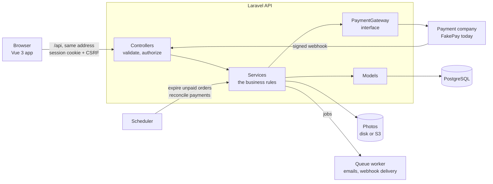
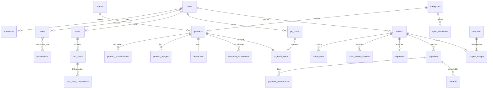

# Architecture

How the shop is put together, the decisions behind it, and what enforces each rule. For how a particular feature works,
see the feature pages: [catalog and PC builder](catalog-and-pc-builder.md), [cart and checkout](cart-and-checkout.md),
[payments and refunds](payments-and-refunds.md), [admin area](admin.md).

## The pieces

Two applications in one repository: `backend/` is a Laravel API with no HTML pages of its own, and `frontend/` is a Vue
single-page app. In development the Vite server forwards `/api` to the API; in production the web host does the same
(`netlify.toml`). The browser therefore always talks to one address, which is what lets the login be a cookie.

## Layers of the API

| Layer | Where | Job | Rule |
|---|---|---|---|
| Routes | `routes/api.php` | Address, login requirement, permission, rate limit | Every protection is visible in one file |
| Form requests | `app/Http/Requests` | Is what was sent acceptable? | No business rules; only shape and limits |
| Controllers | `app/Http/Controllers/Api` | Hand the validated input to a service, wrap the result | Thin: a few lines each |
| Services | `app/Services` | The business rules, inside database transactions | The only place that changes money, stock or status |
| Models | `app/Models` | One row; relationships; casts to `Money`, enums, dates | No workflow logic |
| Resources | `app/Http/Resources` | What a record looks like as JSON | The only place that decides what a role may see |
| Policies | `app/Policies` | May this person touch *this* record? | Another customer's record answers 404 |

A request for "place my order" passes through `PlaceOrderRequest` (an address id, an optional coupon and note; there is
no field for a price), `CheckoutController` (three lines) and `CheckoutService::place`, which does everything in one
transaction and returns the order that `OrderResource` turns into JSON.

## Decisions, and why

| Decision | Why | Where |
|---|---|---|
| **Money is a whole number of sen**, wrapped in a `Money` value object | Decimals drift (`0.1 + 0.2`). Whole numbers do not, and the database can check that `total = subtotal - discount + shipping` exactly | `app/Support/Money.php`, `app/Casts/MoneyCast.php` |
| **The server decides every amount.** The browser sends choices (which product, which address, which coupon), never prices | Anything a browser sends can be edited by its user | `CartEvaluator`, `CheckoutService` |
| **Cookie login (Sanctum SPA) on one address**, not a token in the browser's storage | An `httpOnly` cookie cannot be read by injected JavaScript, so a script flaw cannot steal the login. CSRF protection covers what cookies add | `bootstrap/app.php`, `netlify.toml` |
| **Permissions are data** (`orders.manage`, `refunds.manage`...), checked by `can:` on the route | Who may do what changes more often than code does; a new permission needs no code | `RolePermissionSeeder`, `Gate::before` in `AppServiceProvider` |
| **Specifications are data**, not columns | A motherboard and a power supply have nothing in common. Filters, forms and validation are generated from each category's definitions | `spec_definitions`, `product_specifications` |
| **Compatibility checks are one small class each**, switched and tuned from the database | A rule can be tested without a database, added without touching the others, and turned off without a deployment | `app/Services/Compatibility/Rules` |
| **An order has two statuses**: what is happening to the goods, and what happened to the money | "Paid but not shipped" and "shipped but refunded" are both real; one column cannot say both | `OrderStatus`, `PaymentStatus` |
| **Every allowed status change is listed**; anything else is refused | A cancelled order can never become shipped by accident | `OrderStatus::nextStatuses()` |
| **Stock is reserved by the order, not by the cart**, under row locks taken in a fixed order | A cart can sit for weeks. Locks stop two buyers taking the last unit; the fixed order stops two checkouts deadlocking | `StockReservation` |
| **An order line copies the name, SKU and price** | An order must still say what was bought, and for how much, after the product changes or is deleted | `order_items` |
| **The shop talks to an interface, not to a payment company** | Changing company means writing one class; checkout, refunds and reconciliation do not change | `Contracts/PaymentGateway.php` |
| **Only a signed webhook marks an order paid** | The page a customer returns to proves nothing: the address can be typed by hand | `PaymentWebhookController`, `PaymentProcessor` |
| **A webhook is recorded in the same transaction as its effects** | If processing fails, the "seen it" record disappears too and the company's retry is processed normally; if it succeeds, a second delivery finds the record and does nothing | `webhook_events`, `PaymentProcessor` |
| **The payment company is called outside the database transaction**, with the refund's id as the idempotency key | A slow company must not hold locks; a timeout can be retried without refunding twice | `RefundService` |
| **Orders, payments and refunds use ULIDs**; catalog records use numbers | An order id in an address must not reveal how many orders exist or let anyone guess the next one | migrations |
| **Tests run on PostgreSQL**, not on a lighter stand-in | The rules that matter (row locks, `CHECK`s, partial unique indexes, a trigger) only exist there | `phpunit.xml`, `tests/Concurrency` |
| **The API reference is generated and then tested against real answers** | Hand-written documentation goes stale; generated documentation can still be wrong | `ApiDocsServiceProvider`, `tests/Feature/ApiDocs` |
| **Loading a relationship lazily is an error outside production** | A forgotten eager load fails a test instead of quietly running a query per row | `AppServiceProvider` |

## Database design

The main tables and how they relate (framework tables such as `sessions`, `jobs` and `cache` are left out):

`webhook_events`, `audit_logs` and `compatibility_rules` stand apart: a webhook event is identified by the payment
company's own event id, an audit entry points at whatever it describes, and a compatibility rule's row holds only its
settings.

### What the database itself refuses

Application code can have bugs, so the rules that must never break are also written into the database:

| Rule | How |
|---|---|
| An order's total adds up, and a discount never exceeds the subtotal | `CHECK (total = subtotal - discount_total + shipping_total AND discount_total <= subtotal)` |
| Stock held for orders never exceeds stock | `CHECK (reserved <= stock)` on `inventories` |
| No more is refunded than was paid | `CHECK (refunded_amount <= amount)` on `payments` |
| A sale price is below the price | `CHECK (discount_price IS NULL OR discount_price < price)` |
| Amounts and quantities are positive | `CHECK`s on `payments.amount`, `refunds.amount`, `order_items.quantity`, cart and build quantities |
| One payment page open per order | partial unique index on `payments (order_id)` while `PENDING` or `PROCESSING` |
| One refund request waiting per order | partial unique index on `refunds (order_id)` while `REQUESTED` |
| The same checkout is one order | unique `orders (user_id, idempotency_key)` |
| The same webhook is processed once | unique `webhook_events (provider, event_id)` |
| One cart line per product, one default address per customer | partial unique indexes |
| A payment's history cannot be rewritten | a trigger refuses `UPDATE` and `DELETE` on `payment_transactions` |
| A record others depend on cannot vanish | foreign keys that restrict deletion: a product that is on an order, an order that has payments, a customer who has orders |

Search uses trigram indexes on product name and SKU (`pg_trgm`), so "ryzn" still finds "Ryzen".

## Security

| Concern | What is done |
|---|---|
| Who is this? | Session cookie (`httpOnly`, `SameSite=Lax`, `Secure` in production) with CSRF tokens. Login and registration are rate limited. A deactivated account is signed out on its next request |
| May they do this? | A permission on the route for staff actions; a policy for "is this record theirs". Another customer's order answers 404 |
| Is the input acceptable? | A form request per endpoint. Uploaded images are decoded and re-encoded as WebP under a random name, so nothing hidden in a file survives |
| Is this webhook genuine? | HMAC-SHA256 over the time and the exact body, compared in constant time; older than five minutes is refused |
| Can a request be repeated? | Checkout takes an idempotency key; webhooks and refunds are idempotent by design |
| What does an error reveal? | `{ "message": ... }` and nothing else, in every mode. An unexpected failure is logged, not shown |
| What may a browser do with an answer? | `nosniff`, no framing, a referrer and a permissions policy, HSTS over https, a deny-all content policy on API answers and a strict one (no `unsafe-*`) on the website. Only the shop's own site may read API answers from a browser |
| Who did what? | An append-only audit log, with passwords, tokens and secrets stripped before writing |
| Secrets | Only in `.env` files that git ignores, or in the host's settings. The fake gateway refuses to run in production |

## Tests

| Kind | What it covers | Where |
|---|---|---|
| Unit | `Money`, shipping, order state moves, each compatibility rule, webhook signatures | `backend/tests/Unit` |
| Feature | Every endpoint through real HTTP against PostgreSQL: happy paths, permissions, validation, and the money rules (duplicate webhooks, late payments, double refunds, wrong amounts) | `backend/tests/Feature` |
| Concurrency | Real processes racing for the last units of stock, and one customer's checkout sent several times at once | `backend/tests/Concurrency` |
| Reference | Real answers validated against the API reference; the published copy must be current | `backend/tests/Feature/ApiDocs` |
| Deployment | The install command, the schema guard, photo storage, proxy headers | `backend/tests/Feature/Deploy` |
| Frontend | Stores, pages and components with Vitest and Vue Test Utils | `frontend/tests` |

Static analysis (PHPStan level 5 with Larastan) and code style (Pint; ESLint and Prettier) run with them, locally and in CI.
