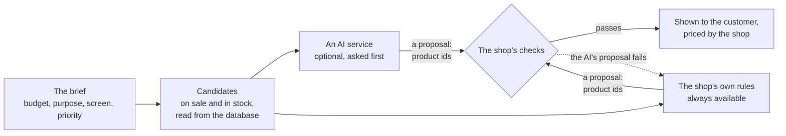

# The catalog, the PC builder, the compatibility engine and build suggestions

> The exact request and response of every endpoint is in the API reference ([`/docs/api`](http://localhost:8000/docs/api) when the
> app is running, or [`backend/openapi.json`](../backend/openapi.json)), which is generated from the code and tested against
> real answers. This page explains how the feature works and why.

## Catalog

Every category describes its own specifications as **data** (`spec_definitions`: key, label, type, unit, allowed options,
whether it is a filter, whether it shows on product cards), and each product stores one typed value per specification
(`product_specifications`). The shop's filters, the product page's table, the admin form and the validation of a product
are all generated from those rows. A new kind of part, or a new specification, needs rows, not code.

Amounts are always **integer sen** (`RM 4,602.00` = `460200`). Reads are public; writes need the permission shown.

| Endpoint | Auth | Notes |
|---|---|---|
| `GET /api/products` | public | `q`, `category`, `brands[]`, `price_min`, `price_max` (sen), `in_stock`, `specs[key][]`, `specs[key][min]`, `sort` (`relevance\|popular\|newest\|price_asc\|price_desc`; `relevance` is the default while `q` is set), `per_page` (max 48), `page` |
| `GET /api/products/{id\|slug}` | public | Full product with specifications. Drafts return 404 for customers |
| `GET /api/categories` · `GET /api/brands` | public | With published product counts |
| `GET /api/categories/{slug}/filters` | public | Brands, price range and spec filter options with counts, built from the database |
| `GET /api/admin/products` | `products.manage` | Includes drafts and archived; `status` filter |
| `POST/PUT/DELETE /api/products[/{id}]` | `products.manage` | Specs are validated against the category's definitions; price changes are audit-logged |
| `POST/DELETE /api/products/{id}/images[/{image}]` | `products.manage` | JPG/PNG/WebP, max 3 MB, re-encoded to WebP, max 8 per product |
| `POST /api/products/{id}/inventory/adjustments` | `inventory.manage` | Locks the row, never below zero or reserved, writes a movement and an audit entry |
| `POST/PUT/DELETE /api/categories` · `/api/brands` | `categories.manage` / `brands.manage` | Cannot delete while products exist |
| `POST /api/categories/{slug}/specs` · `PUT/DELETE /api/spec-definitions/{id}` | `categories.manage` | Add specs to a category with no code change |

## PC builder

| Endpoint | Auth | Notes |
|---|---|---|
| `GET /api/pc-builder/components` | public | The slots (CPU, motherboard, ...) in screen order, whether each is required, its max quantity and the category that supplies it |
| `POST /api/pc-builder/validate` | public (throttled) | Body `{items: [{slot, product_id, quantity}]}`. Returns the build **recalculated from database prices and stock**: line totals, subtotal (sen), missing required slots and issues (`out_of_stock`, `insufficient_stock`, `product_unavailable`). Client prices are ignored. Products that are not on sale are never revealed |
| `GET/POST /api/builds` | customer | List (with totals) / save a build. Incomplete builds can be saved. Max 25 per customer |
| `GET/PUT/DELETE /api/builds/{id}` | owner only | Anyone else gets `404`. `PUT` can rename and/or replace the parts |
| `POST /api/builds/{id}/duplicate` | owner only | Creates "Copy of ..." |
| `POST/DELETE /api/builds/{id}/share` | owner only | Start or stop sharing by link ([below](#sharing-a-build)) |
| `GET /api/shared-builds/{token}` | public (throttled) | A shared build, read-only |
| `POST /api/pc-builder/recommendations` | public (throttled) | A build suggested for a budget ([below](#build-suggestions)) |

A build stores only *which* products and how many. Prices are always read live, so a saved build never shows a stale price.

## Compatibility engine

A build is checked by small **rule classes** in `backend/app/Services/Compatibility/Rules/`, one per check, listed in
`config/compatibility.php`. `CompatibilityService` runs the enabled rules and returns a report: `compatible`, `warning`
(only warnings) or `incompatible` (at least one error). **Errors block buying a build; warnings never do.**

| Rule | Default | Checks |
|---|---|---|
| `cpu_socket_matches_motherboard` | error | AM5 CPU needs an AM5 board |
| `ram_type_matches_motherboard` | error | DDR4 vs DDR5 |
| `ram_modules_fit_motherboard` / `ram_capacity_within_motherboard_limit` | error | sticks <= slots, total GB <= board maximum |
| `motherboard_fits_case` | error | ATX / Micro ATX / Mini ITX support |
| `gpu_fits_case` | error | card length <= case maximum |
| `cooler_fits_case` | error | air cooler height <= case maximum (liquid coolers skipped) |
| `cooler_supports_cpu_socket` | error | mounting kit supports the CPU socket |
| `cooler_cools_cpu` | warning | cooler rating >= CPU TDP |
| `psu_covers_estimated_load` | error | PSU >= CPU + GPU + 80 W |
| `psu_has_headroom` | warning | PSU >= estimate + 30%, rounded up to 50 W (e.g. 420 W -> 550 W) |
| `psu_meets_gpu_recommendation` | warning | PSU >= the GPU maker's recommendation |
| `psu_fits_case` | error | ATX PSU in an SFX-only case |
| `storage_fits_m2_slots` | error | M.2 drives <= board M.2 slots |
| `cpu_needs_graphics_card` / `cpu_cooler_required` | warning | CPU without iGPU / without a bundled cooler, and the slot is empty |

- **Rules are data-tolerant:** a rule that is missing a part or a spec stays silent instead of guessing. A contract test
  fails if a rule reads a spec key that the catalog does not define, so renaming a spec cannot quietly disable a rule.
- **Adding a rule:** write a class (extend `AbstractRule`), add it to `config/compatibility.php`, run
  `php artisan db:seed --class=CompatibilityRuleSeeder`. Rules are plain PHP objects and need no database to unit-test.
- **Admin control without a deployment:** the `compatibility_rules` table stores, per rule, on/off, severity and tunable
  numbers (`base_system_watts`, `headroom_percent`). Missing rows fall back to the defaults, so a forgotten seed never disables checks.

| Endpoint | Auth | Notes |
|---|---|---|
| `POST /api/pc-builder/validate` | public | Also returns `compatibility: {status, issues[{rule, severity, message, slots}], metrics{estimated_power_watts, recommended_psu_watts}}` and a `purchasable` flag that includes compatibility |
| `GET /api/pc-builder/parts` | public | Smart filtering: `slot`, the usual product filters, and the build so far as `parts[cpu][id]=5&parts[ram][id]=12&parts[ram][qty]=2`. Parts come back **compatible, then warning, then incompatible**, each with its `compatibility` verdict. Incompatible parts are hidden unless `include_incompatible=1` |
| `GET /api/compatibility-rules` | `compatibility.manage` (admin) | Every rule with its settings and defaults |
| `PUT /api/compatibility-rules/{key}` | `compatibility.manage` | `is_enabled`, `severity`, `params`. Validated per rule, audit-logged |

Smart filtering judges only the candidate: a problem that already exists between two other parts is not blamed on every
candidate, and "missing part" rules (no iGPU, no cooler) are skipped because a single part cannot be blamed for a slot that is still empty.

## Build suggestions

"Suggest a build for me" in the PC builder asks for a **budget**, what the PC is **for** (gaming, video editing and 3D,
or office work), the **screen** it will drive and **what matters most** (best performance, balanced, save money). The
answer is a complete PC from the catalog with a reason for each part and what is left of the budget. One click loads it
into the builder, where it is an ordinary build that can be changed, saved or bought.

Two things can choose the parts. Neither is trusted:

**The rules** (`RuleBasedRecommender`) need no account and cost nothing. Each purpose splits the budget differently (a
gaming PC puts 38% into the graphics card, an office PC puts nothing into one and uses the processor's built-in
graphics). The rules pick the best part each share can buy, then swap parts for cheaper or better ones until the build
fits the budget and little is left over. A processor sold without a cooler gets one, and the power supply is the
smallest that covers the build with room to spare. "Save money" aims at 90% of the budget. The same catalog and brief
always give the same build. A budget below the cheapest possible PC is refused with the amount that would be enough.
"Best" means by specification where the catalog can tell (threads for editing, memory size, storage size and speed,
enough graphics memory for the screen) and by price otherwise. There is no benchmark data behind it.

**The AI** is optional (`RECOMMENDER_DRIVER=ai`). It is given the brief and, for each slot, up to eight real products
with their ids, prices and the specifications that matter, and is asked for one id per slot with a short reason. It
speaks the "OpenAI chat completions" format, so Groq, OpenRouter, GitHub Models or a model on your own computer all
work by changing three settings (`AI_BASE_URL`, `AI_API_KEY`, `AI_MODEL`). No customer data is sent: not a name, not an
email, not an order.

**The checks** (`RecommendationService`) are the same whoever made the proposal:

1. Every product must be one that was offered, in the slot it was offered for. An invented id, a product in the wrong
   slot or one that sold out in the meantime fails here.
2. The build is priced and judged by `BuildEvaluator`, the same code the builder, the cart and checkout use: it must be
   complete, in stock and free of compatibility errors, and it must not be missing something a PC cannot run without
   (a graphics card for a processor with no built-in graphics, a cooler for a processor sold without one).
3. The total, **at the shop's prices**, must be within the budget. A price the AI states is never read.

If the AI's proposal fails any step, or the service is slow, down, over its allowance or answers with something
unreadable, the rules answer instead and the customer is told the store's rules chose the build. The customer always
gets a valid build; they never see an error because of the AI.

| | |
|---|---|
| What the AI can do | Choose among products the shop offered it, and write a sentence about each (shown as plain text, cut to length) |
| What it cannot do | Add a product, set or change a price, get past a compatibility error, see anything about a customer |
| What limits its cost | One answer is remembered for an hour for the same brief and catalog; `AI_DAILY_LIMIT` stops asking for the day; each visitor may ask ten times a minute |

Every suggestion is recorded in `build_recommendations` (the brief, who chose, the total, whether the customer loaded
it, and why the AI was not used when it was asked), which is what the admin [Insights](admin.md#insights) page counts.

| Endpoint | Auth | Notes |
|---|---|---|
| `GET /api/pc-builder/recommendations/options` | public | The form's choices, the budget limits and whether an AI is switched on |
| `POST /api/pc-builder/recommendations` | public, 10 a minute | Body `{budget, purpose, priority?, resolution?, games[]?}`, with `budget` in sen. Returns the build exactly as `/validate` would, plus `reasons`, `notes`, `source` (`rules` or `ai`) and `remaining`. `422` with the minimum budget when no PC fits |
| `POST /api/pc-builder/recommendations/{id}/accept` | public | Records that the customer loaded the suggestion. Only for the shop's statistics |

**What was tested.** The rules were checked against small catalogs with a known best answer and against the whole demo
catalog (the cheapest build they find equals the cheapest found by trying every combination). The AI path was tested by
playing the AI service, both inside the test suite and over real HTTP against a stand-in server made to answer well,
invent a product, pick parts that clash, answer in prose, fail and time out. It has **not** been run against a real AI
company's service, which needs an account; the first suggestion after switching it on is that test, and Insights shows
whether the AI's builds are being used.

## Sharing a build

On **My builds**, the owner of a saved build can create a link to it and send it to anyone.

- The link is `/shared/<token>`, where the token is 40 random letters and digits made by the server. It cannot be
  guessed from the build's id, and a wrong or malformed token gets the same `404` as one that never existed.
- The page shows the build's name, its parts with **today's** prices and stock, the total and the compatibility
  verdict. It does not show whose build it is, and a part that is no longer on sale is not named.
- "Open in the builder" loads a **copy** into the visitor's own builder. Nothing a visitor does changes the original.
- **Stop sharing** switches the link off for good. Sharing the build again makes a new link; the old one stays dead.

| Endpoint | Auth | Notes |
|---|---|---|
| `POST /api/builds/{id}/share` | owner only | Returns `{token, path, shared_at}`. Asking again returns the same link |
| `DELETE /api/builds/{id}/share` | owner only | The link stops working at once |
| `GET /api/shared-builds/{token}` | public, 60 a minute | The build, read-only, without its id or its owner |
